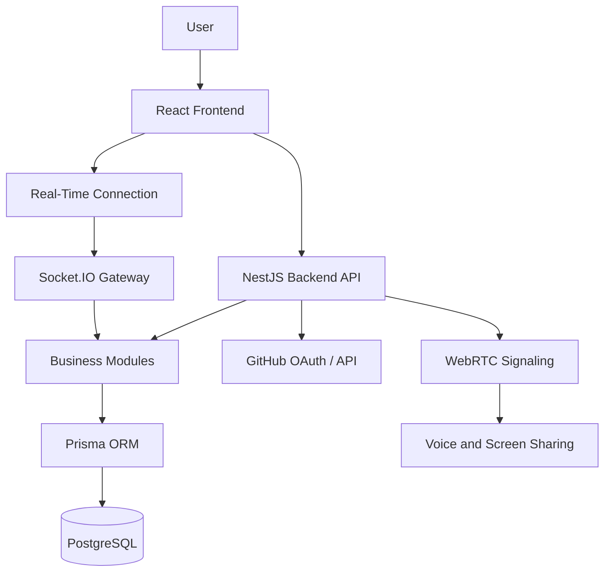

# Nook — System Architecture

**Document:** System Architecture  
**Version:** 1.0  
**Status:** Initial technical design  
**Project:** Nook

## 1. Purpose

This document defines the initial technical architecture of Nook, including its application structure, technology stack, system components, communication patterns, security boundaries, and deployment strategy.

It serves as a technical reference for implementation and must remain consistent with the system requirements, business rules, database model, and MVP implementation plan.

The architecture describes the intended system design. It does not imply that the components or features have already been implemented.

## 2. Architectural Overview

Nook will initially follow a **modular monolith architecture**.

The frontend and backend will be developed as separate applications, while the backend will organize its business logic into clearly defined modules within a single deployable application.

This approach provides:

- Clear separation of responsibilities.
- Easier development and testing for a solo developer.
- Centralized authorization and business rules.
- Simpler deployment and infrastructure management.
- The possibility of extracting services later if measurable requirements justify it.

Microservices will not be introduced during the initial MVP without a concrete technical need.

### High-Level Architecture



The diagram represents logical responsibilities. Real-time signaling, media transport, and production infrastructure must be validated during implementation.

## 3. Technology Stack

| Layer | Technology | Responsibility |
|---|---|---|
| Frontend | React | User interface and interactive components |
| Frontend language | TypeScript | Type safety and maintainability |
| Backend runtime | Node.js | Server-side execution |
| Backend framework | NestJS | API, modules, validation, and dependency management |
| Database | PostgreSQL | Persistent relational data |
| ORM | Prisma | Database access, schema management, and migrations |
| Real-time communication | Socket.IO | Presence and application events |
| Voice and screen sharing | WebRTC | Peer media communication where appropriate |
| Authentication | Email and GitHub OAuth | User identity and access |
| Version control | Git and GitHub | Source control and collaboration |

Additional libraries and infrastructure services should be selected when implementation requirements are clearer.

The final versions of dependencies must be chosen based on compatibility, security, and maintenance considerations.

## 4. Frontend Architecture

The frontend is responsible for presenting the application, managing local interface state, and communicating with authorized backend endpoints.

### 4.1. Main Responsibilities

- Authentication and account settings.
- Workspace selection and configuration.
- Widget rendering and arrangement.
- Notes, tasks, shortcuts, and productivity tools.
- Temporary sharing and permission interfaces.
- Private rooms and public communities.
- Presence indicators and real-time interactions.
- Voice calls and screen-sharing controls.
- Loading, success, error, and empty states.

### 4.2. Organization

Frontend code should be organized by features and shared responsibilities rather than placed in a single large component.

Suggested structure:

```text
apps/
  web/
    src/
      app/
      components/
      features/
        auth/
        workspaces/
        widgets/
        sharing/
        rooms/
        communities/
        presence/
        calls/
        integrations/
      hooks/
      lib/
      services/
      types/
```

This structure is a proposed starting point. It may be adjusted as the application grows.

### 4.3. Frontend Security Boundary

The frontend may hide unavailable actions and improve the user experience, but it must not be treated as the authority for access control.

All protected operations must be validated by the backend.

Sensitive credentials and authorization secrets must not be embedded in frontend source code or exposed through client-side configuration.

## 5. Backend Architecture

The backend will use NestJS and a modular monolith structure.

Each module will own a clear area of business logic and expose controlled interfaces to other modules.

### 5.1. Proposed Modules

| Module | Responsibility |
|---|---|
| Auth | Registration, login, OAuth, sessions, and account verification |
| Users | User profiles and account settings |
| Workspaces | Workspace ownership, configuration, and layout |
| Widgets | Widget instances and supported productivity data |
| Sharing | Temporary shares, permissions, expiration, and revocation |
| Invitations | Invitation creation, validation, and usage limits |
| Rooms | Private rooms and membership |
| Communities | Community management, membership, and join requests |
| Moderation | Reports, blocks, and moderation actions |
| Presence | Real-time status and availability |
| Calls | Call authorization and signaling coordination |
| Integrations | GitHub account connections |
| Audit | Security-relevant and administrative event records |

Modules may share common infrastructure, but business rules should remain within their owning modules whenever possible.

### 5.2. Module Responsibilities

Each module should separate, where useful:

- Controllers or transport handlers.
- Application services and business logic.
- Data access.
- Input validation.
- Authorization policies.
- Domain types and interfaces.

The project should avoid unnecessary abstraction. Structure should support clear responsibilities and testability without making simple features unnecessarily complex.

## 6. API Design

The backend will expose an API for operations initiated by the frontend.

HTTP endpoints should be organized consistently by resource and responsibility. REST-style endpoints are a suitable default for the initial MVP.

Examples of potential resource groups include:

- `/auth`
- `/users`
- `/workspaces`
- `/widgets`
- `/shares`
- `/invitations`
- `/rooms`
- `/communities`
- `/integrations`

These are illustrative route groups, not a finalized endpoint contract.

### API Requirements

- Validate incoming data on the server.
- Return consistent error responses.
- Enforce authentication and authorization on protected endpoints.
- Avoid exposing internal implementation details.
- Apply rate limits to sensitive operations.
- Document endpoints as the API evolves.
- Handle pagination and filtering where collections may grow.
- Prevent unauthorized access through direct requests, regardless of frontend state.

## 7. Database Architecture

PostgreSQL will be the primary persistent database, accessed through Prisma.

The database will store durable application data, including:

- Users and authentication account associations.
- Sessions when server-managed persistence is used.
- User preferences.
- Workspaces and widget configurations.
- Notes, tasks, and shortcuts.
- Temporary sharing permissions and invitations.
- Private room and community membership.
- Moderation records.
- GitHub integration metadata.
- Security audit events.

The detailed entities and relationships are defined in `database-model.md`.

### Data Management Rules

- Use UUIDs as the default primary identifiers.
- Store timestamps in UTC.
- Use foreign keys and constraints to preserve data integrity.
- Add indexes according to expected query patterns.
- Manage schema changes with Prisma migrations.
- Keep database credentials out of source control.
- Separate development, testing, and production environments.
- Define backup and recovery procedures before production launch.

JSONB may be used for flexible widget configuration, but core relationships and authorization data should remain structured and enforceable.

## 8. Authentication and Authorization

Authentication establishes who the user is. Authorization determines which actions that user may perform.

These concerns must remain separate.

### 8.1. Authentication

The initial product supports:

- Email-based authentication.
- GitHub OAuth.
- Account verification and access recovery as required by the authentication flow.
- Session expiration and invalidation.

The specific session mechanism must be selected during implementation. Browser sessions should use appropriate protections, such as secure cookies where applicable, HTTPS, and CSRF defenses when required by the chosen authentication design.

Passwords must be stored using a suitable password-hashing algorithm. OAuth secrets and access tokens must be protected against unauthorized access.

### 8.2. Authorization

The backend must validate:

- Resource ownership.
- Workspace-sharing permissions.
- Share expiration and revocation.
- Private room membership.
- Community roles.
- Invitation validity and usage limits.
- Call participation permissions.
- Access to account and administrative operations.

Authorization must be enforced on every protected operation. A valid login alone must not grant access to another user's private resources.

## 9. Real-Time Architecture

Socket.IO will support real-time application events, including presence updates and relevant changes to connected clients.

Real-time connections must follow the same authentication and authorization policies as HTTP requests.

### 9.1. Presence

The system supports the following presence states:

- Available
- Focus
- Away
- Busy
- Invisible

Presence is primarily transient state. It should not be treated as permanent account data by default.

The implementation must account for connection loss, reconnection, stale sessions, and multiple active connections.

Invisible presence must not be disclosed through public presence lists, search results, or unauthorized last-seen information.

### 9.2. Real-Time Events

Real-time events should:

- Be validated by the server.
- Be delivered only to authorized recipients.
- Avoid including unnecessary private information.
- Handle disconnected clients and reconnection.
- Avoid treating client-reported events as trusted authorization evidence.

The initial implementation should keep event contracts explicit and documented.

## 10. Voice Calls and Screen Sharing

WebRTC is the planned technology for voice communication and screen sharing.

Socket.IO may coordinate signaling, but signaling alone does not transport the media.

The production design may require STUN/TURN infrastructure and, depending on call topology, a media server or selective forwarding unit (SFU).

The final topology must be determined through a technical proof of concept that evaluates reliability, network compatibility, operational cost, and expected group sizes.

### Security Requirements

- Only authorized participants may join a call.
- Screen sharing requires explicit user action.
- A visible indicator must remain active during screen sharing.
- The user must be able to stop sharing immediately.
- The MVP must not provide call recording.
- Signaling messages must be validated and authorized.
- Network and media encryption must be configured appropriately.

End-to-end encryption must not be claimed unless the actual implementation and its limitations have been technically validated.

## 11. GitHub Integration

GitHub integration will use the appropriate authorization flow for the features implemented.

The integration should request the minimum required OAuth scopes and allow users to disconnect their accounts.

Integration tokens must not be exposed to the browser unnecessarily or stored in plain text.

The exact GitHub features included in the MVP must be defined before requesting additional permissions.

## 12. Security and Privacy Architecture

Security is a cross-cutting responsibility rather than a single module.

The architecture must provide:

- Backend-enforced access control.
- Least-privilege permissions.
- Secure authentication and session management.
- Input validation.
- Protection against common web vulnerabilities.
- Rate limiting for sensitive operations.
- Safe secret management.
- Restricted access to logs and audit events.
- Controlled data deletion and ownership transfer.
- Protection of private workspaces and communications.
- Dependency maintenance and security updates.

Temporary access grants must expire and be revocable. Revocation must invalidate authorization for new protected operations, including those initiated over active real-time connections.

Administrative roles in rooms or communities must not grant unrestricted access to personal workspace data.

Security requirements must be validated through automated tests and targeted security reviews before public release.

## 13. Deployment and Environments

The project should maintain separate configurations for:

- Development.
- Testing.
- Production.

Environment-specific configuration must be provided through environment variables or an appropriate secrets-management mechanism.

Actual secrets must never be committed to GitHub. A sanitized `.env.example` file may document required variable names without containing real credentials.

The production deployment plan must define:

- Frontend hosting.
- Backend hosting.
- PostgreSQL hosting.
- HTTPS and domain configuration.
- Database migrations.
- Logging and error monitoring.
- Backup and recovery.
- Health checks.
- Rollback procedures.

Specific hosting providers should be selected after evaluating cost, deployment complexity, reliability, and the project's needs.

## 14. Testing Strategy

Testing should cover both expected behavior and attempts to bypass restrictions.

### Unit Tests

Validate isolated business rules and services, including:

- Permission evaluation.
- Share expiration and revocation.
- Invitation limits.
- Community role restrictions.
- Workspace ownership rules.

### Integration Tests

Validate interactions among:

- API endpoints and the database.
- Authentication and session management.
- Workspace operations and persistence.
- Sharing and permission checks.
- Community membership and moderation.
- Real-time authentication and authorization.

### End-to-End Tests

Validate important user journeys, including:

- Registration and login.
- Workspace creation and configuration.
- Widget persistence.
- Temporary sharing and revocation.
- Community entry.
- Account deletion.

Security-critical flows should receive higher testing priority than cosmetic features.

## 15. Repository Organization

A possible initial monorepo structure is:

```text
nook/
  apps/
    web/
    api/
  packages/
    shared/
  docs/
    product/
    requirements/
    architecture/
  .gitignore
  README.md
```

This structure is a proposal for implementation, not a statement that these directories already exist.

The shared package should be introduced only when there is a clear need to share types or utilities between applications.

The repository should evolve incrementally. Unnecessary packages and abstractions should be avoided during early development.

## 16. Architecture Decisions

| Decision | Initial choice | Rationale |
|---|---|---|
| Application architecture | Modular monolith | Reduces operational complexity while preserving clear module boundaries |
| Frontend | React + TypeScript | Supports component-based interfaces and typed application code |
| Backend | Node.js + NestJS | Provides structured modules and server-side validation |
| Database | PostgreSQL | Supports relational integrity and structured queries |
| ORM | Prisma | Provides schema management, typed access, and migrations |
| Real-time events | Socket.IO | Supports bidirectional application events and reconnection workflows |
| Voice and screen sharing | WebRTC | Provides browser-based real-time media capabilities |
| Primary identifiers | UUIDs | Provides stable identifiers across application domains |
| Presence persistence | Transient by default | Minimizes unnecessary historical tracking |
| Deployment topology | To be selected | Depends on proof of concept, cost, and operational requirements |

## 17. Implementation Roadmap

The architecture should be implemented in stages:

1. Establish the repository, development environment, and application structure.
2. Implement database configuration, migrations, and authentication.
3. Implement workspaces and productivity widgets.
4. Implement temporary sharing, permissions, invitations, and private rooms.
5. Implement communities, membership, and moderation.
6. Implement presence, voice, and screen sharing after validating the required infrastructure.
7. Complete testing, security validation, deployment preparation, and release checks.

The implementation plan defines the detailed sequence and completion criteria.

## 18. Future Evolution

The architecture may evolve as usage and technical requirements become clearer.

Potential future improvements include:

- Separating independently scalable services when justified.
- Introducing dedicated infrastructure for high-volume real-time workloads.
- Improving observability and operational automation.
- Expanding integrations.
- Optimizing database access based on measured performance.

Such changes should be driven by evidence, operational needs, and explicit architectural decisions rather than premature complexity.

## 19. Related Documents

- [`database-model.md`](database-model.md) — database entities, relationships, and data protection rules.
- [`../requirements/system-requirements.md`](../requirements/system-requirements.md) — functional, non-functional, security, and acceptance requirements.
- [`../product/business-rules.md`](../product/business-rules.md) — product behavior, permissions, and business constraints.
- [`../product/implementation-plan.md`](../product/implementation-plan.md) — implementation phases and completion criteria.

## 20. Document Maintenance

This document must be updated when technical decisions materially affect:

- System boundaries.
- Data ownership and relationships.
- Authentication or authorization.
- Real-time communication.
- Security and privacy.
- Deployment and operational requirements.

Architecture changes must be reviewed against the database model, system requirements, business rules, and implementation plan.
