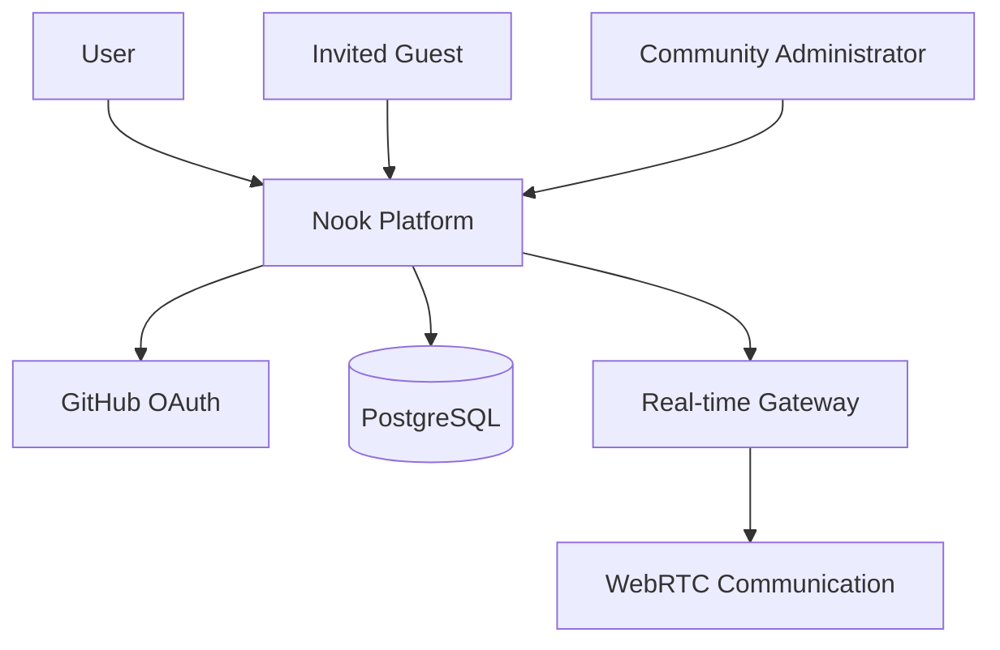
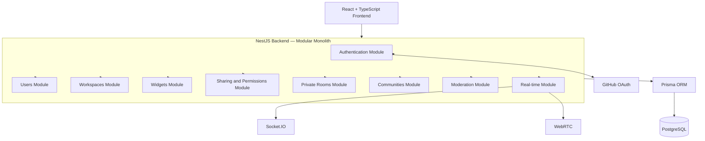
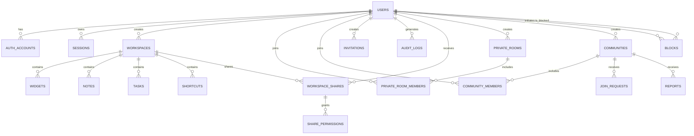
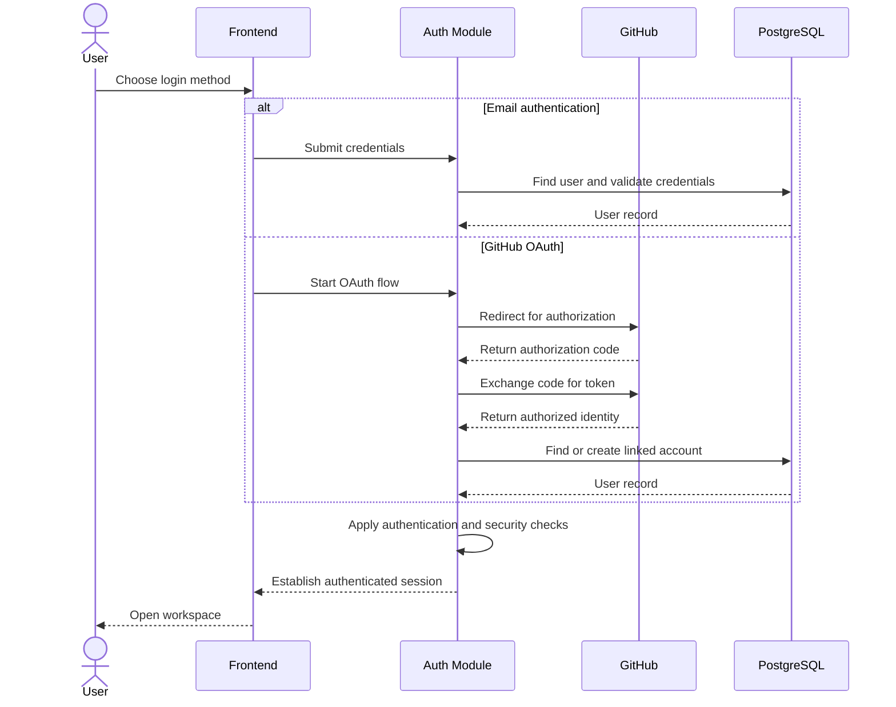
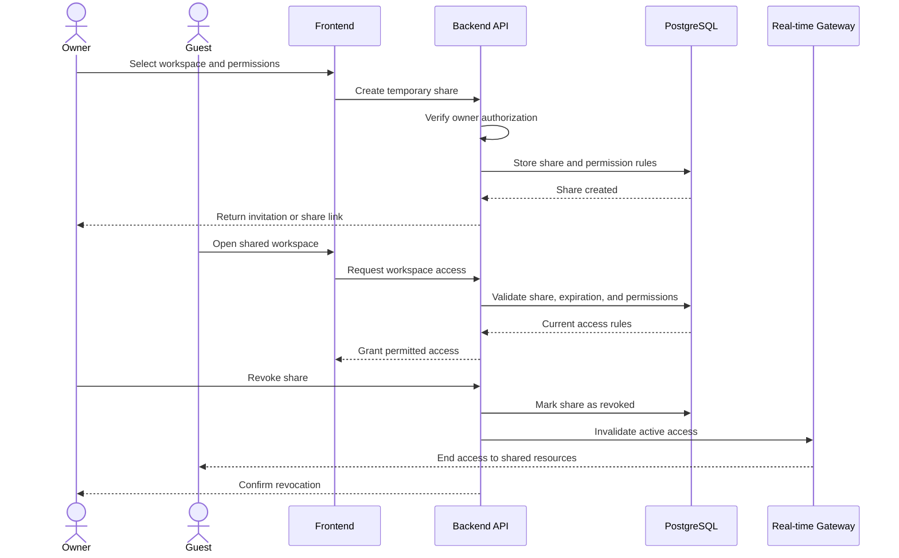
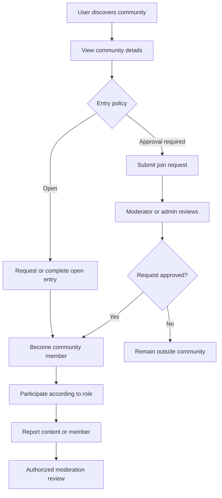
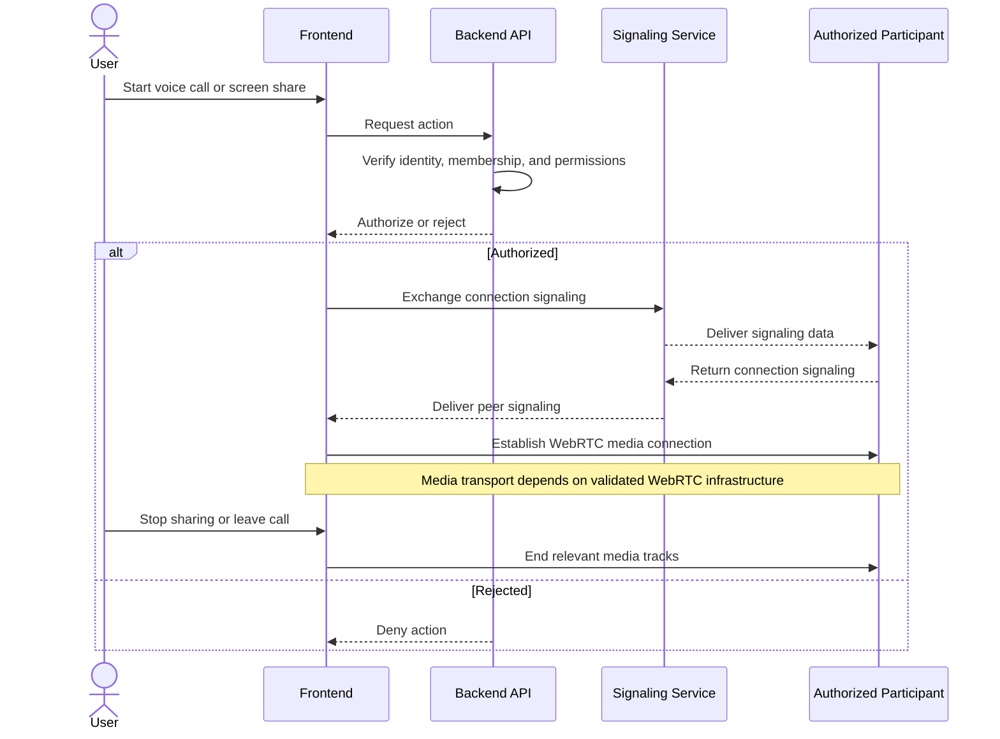
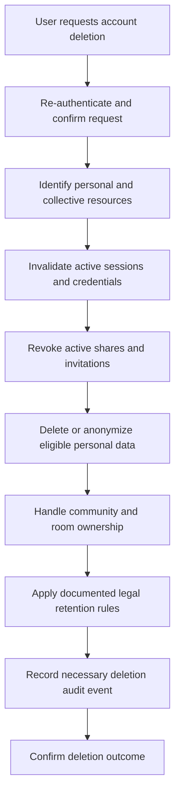
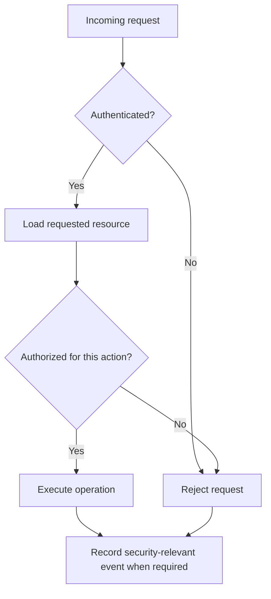

# Nook — System Diagrams

This document provides visual representations of Nook's architecture, data model, and critical user flows.

The diagrams use Mermaid syntax and are intended to support development, technical reviews, and system documentation.

## 1. System Context

This diagram shows the main actors and external services that interact with Nook.

## 2. Application Architecture

Nook follows a modular monolith architecture for the initial MVP. Modules share one backend application while maintaining clear domain boundaries.

## 3. Database Entity Relationships

This is a high-level view of the main entities. The complete database model defines detailed attributes, constraints, indexes, and access rules.

## 4. Authentication Flow

Nook supports email-based authentication and GitHub OAuth. Authentication must establish a verified user identity before granting access to protected resources.

## 5. Workspace Sharing and Permission Revocation

Workspace access must follow explicit permissions. Revoked or expired permissions must not become valid again automatically.

## 6. Community Entry and Moderation

Communities can allow open entry or require approval. Membership roles determine permitted actions but never grant access to private personal workspaces.

## 7. Voice Calls and Screen Sharing

Voice and screen-sharing features require authorized participation. Screen sharing must be initiated explicitly, visibly indicated, and stoppable immediately by the sharing user.

**Implementation note:** WebRTC signaling, STUN/TURN configuration, and any need for an SFU must be validated through a technical proof of concept before production deployment. This diagram does not imply that end-to-end encryption has been independently validated.

## 8. Account Deletion

Account deletion must account for personal data, active sessions, shared resources, and collective resources. Retention obligations must be reviewed before final implementation.

## 9. Core Authorization Principle

Every protected operation must be authorized by the backend. Hiding a button in the frontend is not a security control.

Authorization checks must consider the resource owner, the requesting user's current role, explicit permissions, expiration, revocation, and resource-specific rules.

## 10. Diagram Maintenance

- Keep diagrams consistent with the system requirements, business rules, database model, and architecture specification.
- Update diagrams whenever a change affects module boundaries, entity relationships, authorization, or critical user flows.
- Treat these diagrams as documentation, not as proof that the described features have already been implemented.
- Validate Mermaid syntax and diagram rendering during documentation reviews.
- Document unresolved infrastructure and security decisions before production implementation.
